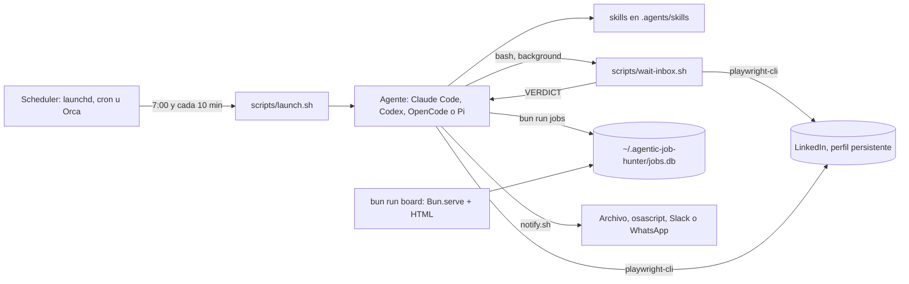

# agentic-job-hunter

Un agente de IA que atiende a los reclutadores que te escriben por LinkedIn y te ayuda a postular con un CV adaptado a cada oferta. Todo queda registrado en un panel Kanban local.

## Aviso importante

> **LinkedIn prohíbe la automatización** en sus términos de uso. Usar este proyecto puede llevar a que restrinjan o cierren tu cuenta. Es **bajo tu propia responsabilidad**. La cuenta del autor ya fue restringida una vez.

Para reducir el riesgo:

- Mantén los topes bajos. El máximo que usa el proyecto es **33 envíos y 40 lecturas por día**; recomendado, menos.
- Deja la autonomía en el valor por defecto: **pedir aprobación antes de enviar o postular**.
- No uses MCPs ni APIs no oficiales de LinkedIn.
- Si LinkedIn muestra un aviso de restricción, el agente se pausa 7 días. No lo saltes.

Este repo no hace prospección en frío ni envía invitaciones: solo responde a quien te escribió.

## Qué es

- Lee tu bandeja de LinkedIn con un navegador real y un perfil persistente (`playwright-cli`).
- Clasifica cada oferta, la compara con tus preferencias (rango, modalidad, país, stack) y decide: interés, pedir datos o declinar.
- Registra cada oferta en un Kanban local (SQLite) con etapas, notas e historial.
- Prepara un CV por oferta a partir de tu perfil, sin inventar datos.
- Puede coordinar la entrevista con tu calendario (opcional).
- Funciona con Claude Code, Codex, OpenCode y Pi.

## Requisitos

- [Bun](https://bun.sh) 1.1 o superior.
- [`playwright-cli`](https://www.npmjs.com/package/@playwright/cli) y Chrome.
- `jq` y `bash`.
- Uno de estos agentes: Claude Code, Codex, OpenCode o Pi.
- Python 3 con `python-docx` (solo para generar CV) y LibreOffice (opcional, para PDF).
- Una cuenta de LinkedIn tuya.

## Instalación en 6 pasos

1. Clona el repo y entra: `git clone https://github.com/upex-galaxy/agentic-job-hunter.git && cd agentic-job-hunter`.
2. Aplica la compatibilidad con tus agentes: `bun run agents:setup`.
3. Ejecuta el asistente: `bun run setup`. Pregunta tus preferencias, el nivel de autonomía y las notificaciones, y abre el navegador para que inicies sesión en LinkedIn a mano. Sin preguntas: `bun run setup --yes --autonomy ask_before_send` (ver `bun run setup --help`).
4. Completa `cv/base/profile.json` con tus datos reales (ver `cv/base/profile.template.json`). Para generar CV, crea el venv: `python3 -m venv .venv && .venv/bin/pip install -r .agents/skills/cv-tuning/scripts/requirements.txt`.
5. Valida los selectores de la bandeja con tu sesión (`docs/selectors.md`): LinkedIn cambia su HTML y el vigilante depende de ellos.
6. Abre el panel con `bun run board` y lanza el agente con `scripts/launch.sh` (o programa el horario, ver `docs/scheduler.md`).

## Uso

```bash
bun run board                     # panel en http://localhost:4747 (JOBHUNTER_BOARD_PORT cambia el puerto)
bun run jobs add --company Acme --role "QA Engineer" --recruiter "Nombre"
bun run jobs move 1 en_revision
bun run jobs note 1 "pide inglés B2"
bun run jobs log 1 "respondí con el rango y la modalidad"
bun run jobs list
bun run jobs template declinar
```

Etapas del Kanban: `recibida`, `en_revision`, `postulada`, `cv_enviado`, `entrevista`, `negociacion`, `oferta`, `cerrada`, `descartada`. Arrastra las tarjetas entre columnas en el panel.

Horario por defecto: arranque a las 7:00, el vigilante revisa la bandeja hasta las 21:00. Se cambia en `config/schedule.conf`.

Niveles de autonomía (`config/preferences.json`, campo `autonomy`):

| Valor | Significado |
|---|---|
| `ask_before_send` | Por defecto. Pide aprobación antes de enviar o postular |
| `reply_alone_ask_to_apply` | Responde solo, pide aprobación para postular o mandar CV |
| `full_auto` | Hace todo sin pedir aprobación |

## Arquitectura



El vigilante duerme sin gastar tokens y termina con un veredicto: `MENSAJE`, `PENDIENTE`, `RELOJ`, `LATIDO`, `FIN_DEL_DIA`, `SESION_PERDIDA` o `ERROR`. El agente lo atiende y lo relanza. `watcher.alive` evita lanzar duplicados.

```
AGENTS.md                  cuerpo único de instrucciones (CLAUDE.md lo importa)
.agents/skills/            store único de skills
  recruiter-attention/     flujo de la bandeja
  cv-tuning/               CV por oferta, plantilla y build_cv.py
  linkedin-browser/        playwright-cli con perfil persistente
  interview-scheduling/    calendario (opcional)
config/                    schedule.conf, selectors.json y ejemplos; tus preferencias quedan ignoradas
scripts/                   launch, close, vigilante, relojes, notificaciones, setup
src/ board/                CLI de jobs, API y panel
docs/                      scheduler, selectores, pruebas, MCPs y STATUS
```

## Datos y privacidad

El repo no versiona estado ni datos de terceros. Todo lo que se genera vive en `~/.agentic-job-hunter/` (base de datos, diarios, relojes, perfil del navegador) o en rutas ignoradas por `.gitignore` (`cv/base/profile.json`, los `.docx` y `.pdf`, `config/preferences.json`, `.env`). Revisa `git status` antes de cada commit. El panel escucha solo en `127.0.0.1` y no tiene autenticación.

## Pruebas

```bash
bun test
```

Las pruebas no abren LinkedIn ni lanzan agentes: simulan la bandeja con `JOBHUNTER_FAKE_INBOX` y usan `--dry-run`. Ver `docs/testing.md`. Qué está verificado y qué requiere una sesión real de LinkedIn: `docs/STATUS.md`.

## Licencia

MIT. Ver `LICENSE`.
